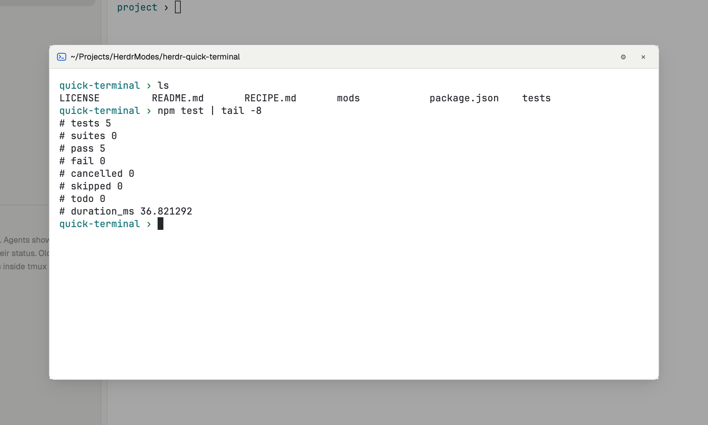

<div align="center">


# Quick Terminal for Herdr

One shortcut brings your shell back where you left it.


</div>

Open a centered, interactive shell from any tab. Type a command, hide the window and carry on working. Open it again to find the output, working directory and command line as you left them. The same local shell is available from every workspace, including remote ones.

## Install

Requires Herdr App and herdr-core. Tested with Herdr App 0.1.13 and 0.1.16 on macOS and herdr-core 0.1.18.

Ask your agent in Herdr:

```text
Read the Herdr app's AGENTS.md, then install https://github.com/dendenlarin/herdr-quick-terminal using its RECIPE.md. Preserve my key bindings.
```

<details>
<summary>Install by hand</summary>

1. Copy `mods/quick-terminal/` into the app home's `mods/` directory (default `~/.config/herdr-app`, or `$HERDR_APP_HOME`). Copy `mod.json` first on a running app. For an upgrade, back up the installed mod, then replace its source files.
2. In the app home's `keys.json`, add the following entry **inside the existing global object**. Check all sections for a conflicting shortcut first. Choose another free chord if needed.
3. Run `herdr-app check /path/to/app-home/mods/quick-terminal` and check `herdr-app status` for errors. Edits load live.

~~~json
"ctrl-`": "mod.open:quick-terminal"
~~~

You can also open the terminal with `herdr-app do mod.open --name quick-terminal` and set a shortcut from its settings.

</details>

## Use

- **Show or hide** with the same shortcut. The × in the header also hides the terminal. Escape goes to the foreground program, so it works in Vim and interactive pickers.
- **Change settings** with the gear in the header. Choose a starting folder (initially your home directory) or record another shortcut. A new folder applies the next time a shell starts. When the configured folder is unavailable, you can choose a replacement or open once in home.
- **Resume** after switching tabs or reopening Herdr App while herdr-core is still running. Terminal scrollback is bounded by the host. Shell command history follows your shell settings.
- **Finish** with `exit`. Your next invocation starts a fresh shell. A reboot also ends the live session.

## What it touches

The mod starts the configured local shell through herdr-core, using a unique live name and a mod label to find it again. Herdr stores the starting folder under `quick-terminal.folder` in shared settings. Changing the shortcut updates its global binding in `keys.json`. Terminal output stays with herdr-core. No network service, background helper or layout edits are required.

## Uninstall

If you want to end the shell, type `exit` first. Remove the global binding whose action is `mod.open:quick-terminal`, then remove `mods/quick-terminal/`. The saved folder is harmless and will be reused after reinstalling.

## Development

Run `npm test` with Node 20+ for the session and shortcut tests. No packages need installing. See [RECIPE.md](RECIPE.md) for the live acceptance checks.

[MIT License](LICENSE)
