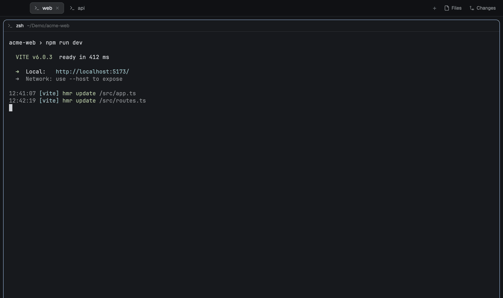

<div align="center">


# Quick Terminal for Herdr

**Your shell, one shortcut away.**

[](https://herdr.dev/mods)
[](LICENSE)



</div>

A mod for [Herdr](https://herdr.dev), the desktop app for running coding agents side by side. Press a shortcut in any space and a shell opens in the middle of the window. Run a command, hide it and carry on; open it again and the output, folder and half-typed command are where you left them.

No daemon, no layout edits — one shortcut and a shell that stays alive.

## How it works

- **Show or hide** with the same shortcut (`` Ctrl+` `` by default). The × in the header hides it too. Escape goes to the program in the terminal, so Vim and pickers keep working.
- **One shell for every space.** It runs in herdr-core on this computer, so it survives switching spaces and reopening Herdr. In a space on another machine the header says **Local**.
- **Or one per project.** Tick **Open in the focused terminal's folder** in settings: the terminal opens in the folder of the terminal you were in, and each folder keeps its own shell. Come back to a project and its output is still there.
- **Settings** behind the gear: the folder mode, the starting folder (your home folder at first), the shortcut, and **End shell** to start over. A new starting folder applies to the next shell.
- **Finish** with `exit` or End shell: the next open starts a fresh shell in the starting folder.

## Install

Needs Herdr 0.1.13+ with herdr-core. Tested with Herdr 0.1.13 and 0.1.16 on macOS.

Ask the agent running in Herdr:

```text
Read ~/.config/herdr-app/AGENTS.md, then install
https://github.com/dendenlarin/herdr-quick-terminal using its RECIPE.md.
Preserve my key bindings.
```

It copies the mod and adds the shortcut from `keys.json` if the chord is free.

<details>
<summary>By hand</summary>

Copy `mods/quick-terminal/` into your app home's `mods/` directory (default `~/.config/herdr-app`, or `$HERDR_APP_HOME`). Write `mod.json` before the other files on a running app, and back up an existing copy when upgrading.

Add the shortcut **inside the existing `global` object** of the app home's `keys.json`, after checking that no section uses the chord already:

```json
"ctrl-`": "mod.open:quick-terminal"
```

Or skip it: open the terminal with `herdr-app do mod.open --name quick-terminal` and record a shortcut in its settings.

```sh
herdr-app check ~/.config/herdr-app/mods/quick-terminal
herdr-app status
```

</details>

## What it touches

- **Runs** your login shell through herdr-core (`hc run`), named `herdr-quick-terminal` and labelled `mod=quick-terminal`. With the folder option each folder gets its own shell, named `quick-terminal-<hash>` and labelled `folder=<path>`. **End shell** and **End N others** run `hc kill` on them.
- **Stores** the starting folder and the folder option in Herdr's shared settings as `quick-terminal.folder` and `quick-terminal.follow`.
- **Writes `keys.json`** only when you record a shortcut in settings. After that edit Herdr treats the whole file as yours and stops adding its new default shortcuts to it; add those by hand.
- **Opens** the GitHub page in your browser when you click its icon in settings.
- No network, no background helper, no layout or agent changes.

## Uninstall

Type `exit` if you want to end the shell. Remove the binding whose action is `mod.open:quick-terminal` from `keys.json`, then delete `mods/quick-terminal/`. The saved folder setting is harmless and is reused if you reinstall.

## Good to know

- The shell always runs on this computer. With the folder option, a terminal on another machine, or no terminal in focus, opens the shared shell in the starting folder.
- Folder shells stay alive until you end them: settings show **End N others** when more than one is open.
- A reboot or a herdr-core restart ends the shell; scrollback is bounded by herdr-core, command history follows your shell.
- With a non-Latin keyboard layout (Russian, Greek…) `` Ctrl+` `` may not match: record the shortcut in settings with the layout you type in.
- Recording a shortcut rejects chords used anywhere in `keys.json`, including the first key of a sequence. `ctrl-alt-shift-escape` is Herdr's escape hatch and can't be taken.

## Development

`main.js` picks its view from `props().role`: none is the launcher, `header` the bar above the terminal, `settings` the dialog. `session.js` finds or starts the shell; `shortcut.js` edits `keys.json`. Run `npm test` (Node 20+, no packages) for the session and shortcut logic, then `herdr-app check mods/quick-terminal` and the checks in [RECIPE.md](RECIPE.md) in a live window.

MIT License
