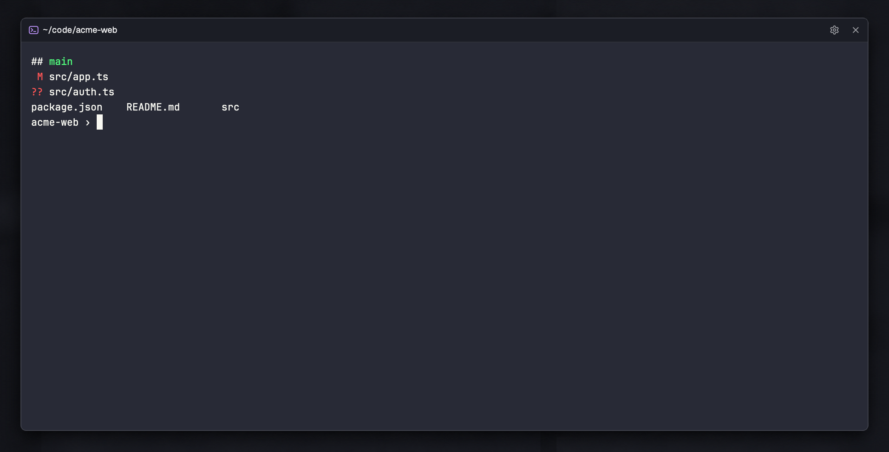

# Quick Terminal

One shell for the whole window, a shortcut away: `mod.open:quick-terminal` (`` ctrl-` ``) opens a centered terminal over whatever space is shown; the same shortcut hides it. The shell lives in herdr-core, so hiding it, switching spaces or reopening Herdr keeps its output, folder and half-typed command. A gear in its header sets the starting folder and the shortcut.

## What you see

- **Dialog**: a modal `dialog` overlay, 70% of the window wide and 60% high, centered, the window dimmed behind it. A column, not resizable:
  - **Header**, 34px, `chrome` background, 1px `border` along the bottom, 10px left / 5px right padding, gap 6, 12px text: a 15px terminal icon (`terminal.svg`) in `accent`; `Local` in `muted` when the shown space is on another machine; the shell's current folder in `foreground`, home shortened to `~`, truncated, filling the row; two 24px icon buttons, radius 5, 14px icons in `muted` (`hover` background and `foreground` on hover): gear (`settings.svg`, tooltip `Quick Terminal settings`) and × (`close.svg`, tooltip `Hide terminal`).
  - **Terminal**: the shell, filling the rest.
- **Settings**, a `dialog` 390px wide over it, `popover` background, 16px padding, gap 12, 13px text, rows with the label left and a text button right (12px `muted`, 8px/4px padding, radius 5, `hover` on hover):
  - `Quick Terminal` semibold, a 24px GitHub icon button (`github.svg`, tooltip `Quick Terminal on GitHub`) and `Done`.
  - `Starting folder`: the folder with `~` for home (tooltip: the full path).
  - `Shortcut`: the bound chord as written in keys.json (`` ctrl-` ``), `Set shortcut` when none, `Press shortcut…` while recording. While recording, a 12px `dim` note: `Esc cancels. Saving rewrites keys.json: Herdr then stops adding its new default shortcuts to it.`
  - `Shell`: `End shell` (tooltip `Close this shell. The next open starts a fresh one in the starting folder.`), only while the shell is live.
  - Errors in 12px `blocked` at the bottom.
- **Can't start** (the starting folder is gone, herdr-core is down): a card in place of the dialog, `popover`, radius 10, 14px padding, gap 8, 13px text: `Could not open Quick Terminal` semibold, the folder in `muted`, the error in 12px, then buttons `Choose folder`, `Open in home`, `Close`.

## How it behaves

- **Shortcut**: `mod.open` toggles the mod's launcher overlay, a frameless `window` that draws nothing; opening it finds or starts the shell and opens the dialog, closing it closes the dialog. Closing the dialog with × or the shell ending closes the launcher too (Esc goes to the shell, never closes the dialog), and Herdr gives focus back to the pane underneath. The terminal gets the keyboard when the dialog opens.
- **One shell**: looked up by label `mod=quick-terminal` among this computer's terminals (addresses without a `machine/` prefix); if none, started with `hc run --bg --json --no-parent --rm --name herdr-quick-terminal --label mod=quick-terminal --cwd <folder>`. Two opens at once: the second `run` fails on the taken name and the lookup runs again, so there is never a second shell.
- **Header folder** follows the shell live (`foreground.cwd`, else `cwd`).
- **Starting folder**: the native folder picker; stored in shared `quick-terminal.folder`; applies to the next shell, never moves the current one.
- **Recording a shortcut**: click the shortcut button, press a chord with `ctrl`, `alt` or `cmd`, or a function key. Esc cancels. Chords already bound in Herdr would run their action first, so while recording they are bound in the settings' key context to recorder actions instead. Every chord then goes through the same check against keys.json read fresh: one used in any section, also as the first key of a sequence, shows `<chord> is already assigned in <section>. Press another shortcut.` and recording goes on; the current shortcut ends recording without writing. Otherwise the mod's bindings in every section are removed and `"<chord>": "mod.open:quick-terminal"` is added to `global`, written only if the file hasn't changed since it was read (one retry after a concurrent change).
- **End shell**: `hc kill` on the shell; the dialog, header and settings close with it.
- No agent statuses: the shell is a plain program.

## Built from

- **Mod** `mods/quick-terminal/`: `mod.json` `{ "place": "none", "title": "Quick Terminal", "overlay": { "kind": "window", "width": 380, "frame": "none" } }`; `main.js`, one `View` with three roles by `props().role`: none (the launcher, also the can't-start card), `header`, `settings`; `session.js` (find or start the shell through `hc`); `shortcut.js` (`rebind`, `saveKey`); icons `terminal.svg`, `settings.svg`, `close.svg`, `github.svg` (Lucide).
- **Dialog**: `openOverlay({ kind: "dialog", modal: true, width: 0.7, height: 0.6, layout: { type: "column", resizable: false, children: [{ type: "block", size: { px: 34 }, content: { mod: "quick-terminal", props: { role: "header", terminal, owner, remote } } }, { type: "block", content: { terminal } }] } })`, where `owner` is the launcher's `props().overlay` and `remote` is whether the focused space has a `machine`. Settings: `openOverlay({ mod: "quick-terminal", kind: "dialog", width: 390, props: { role: "settings", terminal } })`.
- **Cleanup**: `close()` of the launcher closes the dialog; `close()` of the header closes the settings and the launcher.
- **herdr**: `hc` (`ls --json --label`, `run`, `kill`), `terminals`, `focused`, `spaces`, `keys`, `openOverlay` / `closeOverlay`, `props`, `shared` / `setShared` (`quick-terminal.folder`), `pickFolder`, `readTextFile` / `writeTextFile` (`<appHome>/keys.json`), `appHome`, `home`, `theme`, `window` and `exec` (`open` / `xdg-open` / `cmd /c start` for the GitHub link); `cx.bind_keys`, `key_context`, `on_action`, `on_key_down`.
- **keys.json** at the repo root: `{ "global": { "ctrl-`": "mod.open:quick-terminal" } }`.
- Tests: `npm test` (Node 20+, `node:test`) for `session.js` and `shortcut.js`.

## Watch out

- Write `mod.json` (`"place": "none"`) before `main.js`: a new mod folder without it is docked into the shown layout on first sight.
- A layout overlay sends Esc to its terminal, so the dialog needs its own way out: the shortcut and the × button.
- `cx.bind_keys` adds to the app-wide keymap and can't take bindings back: bind each chord once per app run (keep a module-level set), and decide conflicts from keys.json at the moment of the press, not from what was bound earlier.
- Never bind `ctrl-alt-shift-escape`: it is Herdr's escape hatch. `rebind` refuses it.
- Any edit of keys.json makes the whole file the person's: Herdr stops merging new default shortcuts into it. Write it only when the person records a shortcut, and say so.
- A `window` overlay is dragged by any press the mod doesn't stop: stop `mouse_down` on the card's buttons.
- With a non-Latin keyboard layout `` ctrl-` `` may not reach Herdr as that chord; recording in settings uses whatever the layout produces.
- `--rm` removes the shell's record when it exits; a reboot or a herdr-core restart ends it.

## Done when

- `herdr-app check ~/.config/herdr-app/mods/quick-terminal` passes, `npm test` passes, and `herdr-app status` lists no errors.
- From a terminal pane, the shortcut opens the dialog with the cursor in the shell; pressing it again hides it and typing goes back to the same pane. A half-typed command survives hide and reopen. Esc reaches Vim or fzf inside it.
- Start `sleep 5; echo done`, hide, switch space, reopen: the same terminal address and the output are there. Several fast presses never start a second shell (`hc ls --label mod=quick-terminal`).
- `exit` or End shell closes everything; the next open starts a fresh shell in the starting folder.
- A new starting folder applies to the next shell only. With the starting folder deleted, the can't-start card appears and both recovery buttons work.
- Recording a free chord saves it to `global` and it toggles the terminal from terminal focus; a chord used by a terminal or layout binding is refused with its section named and nothing else in keys.json changes; pressing the current shortcut ends recording without writing.
- In a space on another machine the header shows `Local`. The header follows the theme and shortens the home folder.
